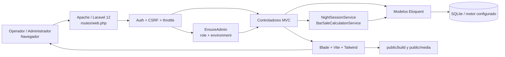

# Documento de Arquitectura de Software (SAD)

**Sistema:** Tío Chu App  
**Versión:** 1.0  
**Arquitectura verificada:** MVC Laravel con servicios de dominio y persistencia Eloquent.

## 1. Alcance y contexto

Tío Chu App es una aplicación web interna para registrar operaciones de bar y licorería por sesión nocturna. El navegador consume rutas web Laravel; controladores validan solicitudes, modelos Eloquent acceden a la base relacional y vistas Blade presentan formularios e indicadores. Los cálculos financieros compartidos se delegan a servicios.

## 2. Vista lógica



### 2.1 Componentes

- **Rutas:** `routes/web.php` define autenticación, sesiones, catálogo, inventarios, ventas, pagos, personal, cierres, multimedia y administración.
- **Controladores:** coordinan validación, autorización, persistencia y respuesta HTML/JSON.
- **Servicios:** `NightSessionService` resuelve la sesión activa/seleccionada, recalcula cierres y consolida resultados de varias noches. `BarSaleCalculationService` calcula combos, mixers incluidos/extras, subtotales y totales de venta.
- **Persistencia:** modelos Eloquent representan entidades de negocio y sus asociaciones.
- **Interfaz:** Blade, assets compilados por Vite 7 y Tailwind CSS 4. La configuración de desarrollo permite HMR local.

## 3. Vista de datos

El diagrama resume claves y cardinalidades implementadas en las migraciones. Las flechas muestran relaciones lógicas Eloquent / claves foráneas; la sesión HTTP de Laravel (`sessions`) es independiente de `night_sessions`.

```mermaid
erDiagram
    USERS {
        bigint id PK
        string name
        string email UK
        string password
        string role
        string avatar
    }
    PRODUCTS {
        bigint id PK
        string name
        string category
        decimal sale_price
        int stock_warehouse
        boolean is_active
    }
    STAFF {
        bigint id PK
        string name
        string role
        decimal default_pay
        string assigned_bar
        boolean is_active
    }
    NIGHT_SESSIONS {
        bigint id PK
        date session_date UK
        string day_name
        string status
        decimal opening_cash
    }
    STAFF_ATTENDANCES {
        bigint id PK
        bigint night_session_id FK
        bigint staff_id FK
        decimal pay_amount
        boolean is_paid
    }
    BAR_SALES {
        bigint id PK
        bigint night_session_id FK
        bigint product_id FK
        string bar_name
        int vendido
        decimal subtotal
    }
    STORE_SALES {
        bigint id PK
        bigint night_session_id FK
        bigint product_id FK
        int quantity
        decimal total_price
    }
    INVOICES {
        bigint id PK
        bigint night_session_id FK
        int correlative_num
        string payment_method
        decimal amount
        decimal net_amount
    }
    QR_PAYMENTS {
        bigint id PK
        bigint night_session_id FK
        string operator_name
        string bank_app
        string point_of_sale
        decimal amount
    }
    EXPENSES {
        bigint id PK
        bigint night_session_id FK
        string category
        string description
        decimal amount
    }
    CASH_CLOSINGS {
        bigint id PK
        bigint night_session_id FK_UK
        decimal total_card
        decimal total_qr_yasta
        decimal total_qr_yape
        decimal net_cash_closing
    }
    BEER_PAYMENTS {
        bigint id PK
        bigint night_session_id FK
        string payment_method
        decimal amount
    }
    PRODUCT_STOCK_MOVEMENTS {
        bigint id PK
        bigint product_id FK
        string movement_type
        int quantity
        int stock_before
        int stock_after
    }
    CATEGORY_MIXER_OPTIONS {
        bigint id PK
        string category
        string mixer_name
        bigint product_id FK
    }
    MEDIA_ASSETS {
        bigint id PK
        string title
        string path
        string category
        string system_key UK
    }

    NIGHT_SESSIONS ||--o{ STAFF_ATTENDANCES : registra
    STAFF ||--o{ STAFF_ATTENDANCES : asiste
    NIGHT_SESSIONS ||--o{ BAR_SALES : registra
    PRODUCTS ||--o{ BAR_SALES : vendido
    NIGHT_SESSIONS ||--o{ STORE_SALES : registra
    PRODUCTS ||--o{ STORE_SALES : vendido
    NIGHT_SESSIONS ||--o{ INVOICES : registra
    NIGHT_SESSIONS ||--o{ QR_PAYMENTS : registra
    NIGHT_SESSIONS ||--o{ EXPENSES : registra
    NIGHT_SESSIONS ||--o| CASH_CLOSINGS : resume
    NIGHT_SESSIONS ||--o{ BEER_PAYMENTS : registra
    PRODUCTS ||--o{ PRODUCT_STOCK_MOVEMENTS : mueve
    PRODUCTS o|--o{ CATEGORY_MIXER_OPTIONS : opcional
```

Las migraciones declaran cascada desde sesiones hacia la mayoría de los registros operativos; `cash_closings.night_session_id` es único (máximo un cierre por noche). El modelo `User` no tiene clave foránea hacia los registros operativos. Las columnas adicionales de inventario, mezclas, comisión, efectivo reportado, imagen y avatar se añaden mediante migraciones posteriores.

## 4. Seguridad

- **Autenticación y sesión:** rutas operativas agrupadas bajo `auth`; formularios mutadores usan protección CSRF estándar de Laravel.
- **Abuso de login:** `POST /login` limita intentos con `throttle:5,1`.
- **Control de roles:** `EnsureAdmin` valida `user()->isAdmin()`. El middleware se aplica a `/users`, cambio/eliminación de sesiones y reapertura de cierres.
- **Túnel de desarrollo:** las rutas `/server/*` utilizan `admin:local`; el middleware rechaza primero entornos distintos de `local` y después exige administrador.
- **Cabeceras HTTP:** `SecurityHeadersMiddleware` añade CSP, `X-Frame-Options`, `X-Content-Type-Options`, `Referrer-Policy` y otras políticas. HSTS solo se establece si la solicitud es segura. Fuentes HMR se permiten únicamente en entorno local.
- **HTTPS:** `AppServiceProvider::boot()` fuerza el esquema HTTPS en producción para URLs y assets.
- **Proxies:** `bootstrap/app.php` incorpora `trustProxies()` y `config/trustedproxy.php` obtiene `TRUSTED_PROXIES` desde entorno; en despliegue debe configurarse con IP/CIDR de proxies confiables, no con valores arbitrarios.
- **Secretos:** `ADMIN_PASSWORD`, `APP_KEY` y credenciales de servicios se configuran como variables de entorno; no se guardan en Git. Los seeders conservan un fallback de desarrollo `tiochu123`, por lo que producción debe definir expresamente `ADMIN_PASSWORD`.

## 5. Despliegue

El `Dockerfile` parte de `php:8.4-apache`, instala extensiones requeridas, compila Composer dependencies, apunta Apache a `public/` y desactiva `expose_php`. El `CMD` ejecuta `php artisan migrate --force`, `php artisan db:seed --force` y luego `apache2-foreground`. El archivo `public/hot` se excluye por `.dockerignore`, para evitar que producción apunte al servidor Vite de desarrollo.

Render termina HTTPS en el servicio/proxy y la aplicación fuerza URLs HTTPS en producción. Con el SQLite predeterminado, el contenedor necesita un disco persistente para conservar datos entre reemplazos; en el plan gratuito con filesystem efímero se recomienda una base administrada configurada por `DB_*`. La ejecución de migraciones y seed al arranque debe coordinarse al escalar a varias instancias para evitar concurrencia de despliegue.

## 6. Atributos de calidad y límites conocidos

- Las métricas verificadas de prueba, cobertura y carga constan en [SQAP Maestro](SQAP-Maestro-General-v4.0.md).
- No se afirma que Render se haya validado en vivo; la evidencia de este documento es estática (configuración del repositorio) y automatizada.
- No existe autorización diferenciada entre `bartender`, `cajero` y `bodeguero` aparte de las rutas que exigen `admin`.
- No se encontró una política de backup automatizada ni un SLO cuantitativo de disponibilidad en el repositorio.
